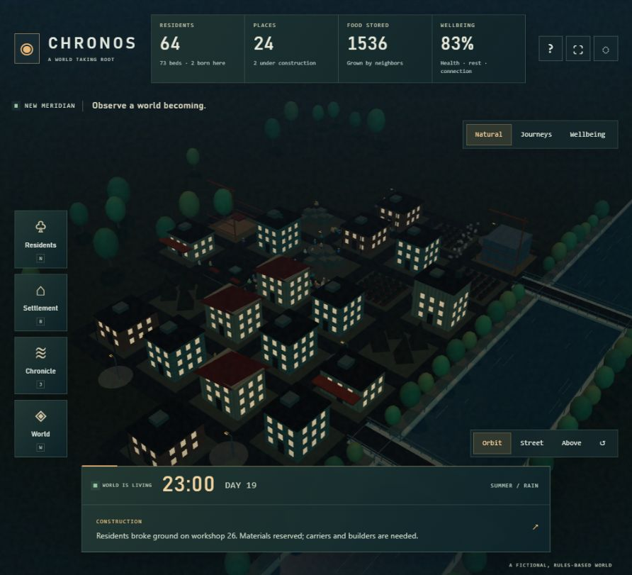

# CHRONOS — A world taking root

A continuously growing, fictional 3D settlement. Observe lives, households, construction and generations. There is one world, no comparison view, no rewind and no play/pause controls. Residents follow needs and working hours; the settlement plans construction from housing and production demands.



## Open and explore

Open `CHRONOS.html` in a current WebGL-capable browser. It contains its code, textures and styles; no network assets or account are required. Direct file launch is designed for offline use but is not browser-verified here because the test browser blocks that protocol. The HTTP preview is verified.

- Drag to orbit 360°, right-drag to pan, scroll/pinch to zoom. Frame the settlement with ↺. Orbit, Street and Above are observation cameras.
- Residents / N: search any living resident, inspect needs and household, Locate or Follow. Children are smaller; workers carry props and builders wear helmets.
- Settlement / B: inspect places, material delivery and construction progress. Houses vary in height, dimensions, facade, color and roof; farms, gardens, woodland lodges, stone yards, care houses and workshops have their own forms.
- Chronicle / J: daily population history, events and links to witnesses.
- World / W: shared stocks, lifetime totals, export/import and a confirmed new-world action.
- F follows the selected resident; 1 / 2 / 3 choose cameras; H hides controls; Escape closes the panel. Buttons and fields retain normal keyboard behavior. The guide explains the rules.

## Life and persistence

A tick represents ten fictional minutes; two ticks advance per real second. A world day takes approximately 72 seconds. Time continues through menus, dialogs and inspection. Browser timers can be throttled when hidden. On return the app simulates elapsed time, up to seven real days, using responsive batches and recovery checkpoints. It does not run on a server while closed. Long absences can need recovery time.

Housing, labor, delivered materials, food, tools, needs, weather, migration, births and compressed ageing drive the outcomes. Growth is conditional: shortages and deaths can slow or reverse it. This local model supports 512 living residents and 256 places; it has no final day. Logs retain 80 events and daily history 90 days. It is not a real-world forecast, AI-trained society or complete ecological model.

Autosave uses the new `chronos.colony` key. Existing `chronos.world` timeline saves are untouched and exportable from World. They are not transformed into invented colony histories. The earlier, compatible game is retained at `archives/CHRONOS-timelines.html`. Save copies before replacing worlds; browser storage is not a backup. Unreadable saves and other-tab changes are protected from automatic overwrites.

## Source and checks

With Node 22.12+ installed:

```sh
git clone https://github.com/Nikhil-4404/chronos.git
cd chronos
npm ci
npm run dev
```

Open the localhost URL printed by Vite. On Windows PowerShell, use `npm.cmd` if script execution policy blocks `npm`.

```sh
npm test
npm run build
npm run preview
```

The build emits both the regular `dist/` site and self-contained root/dist `CHRONOS.html`; it asserts embedded syntax, no external scripts/styles, license inclusion and a below-1-MB size budget. The repository includes the ready-to-open `CHRONOS.html`. No dependency was added.

`src/colony.js` owns living-world behavior and schema 2 validation. `src/app.js` owns wall-clock advancement, observation and storage. `src/city.js` and `src/activity.js` render the actual snapshots. `src/simulation.js` and its tests retain the earlier schema-1 timeline engine for compatibility evidence; it is excluded from the new game bundle.

See [status.md](status.md) for observed checks and remaining limits, [core.md](core.md) for model rules, and [requirements.md](requirements.md) for acceptance criteria. This replaces the active timeline experience at the user's request on 2026-11-06; it is not an additional selectable game mode.

Saved worlds stay in your browser or your own JSON exports. Personal backups are excluded from this repository; a fresh browser starts with the founding settlement. Use World → Export / Import to transfer a colony between browsers.
