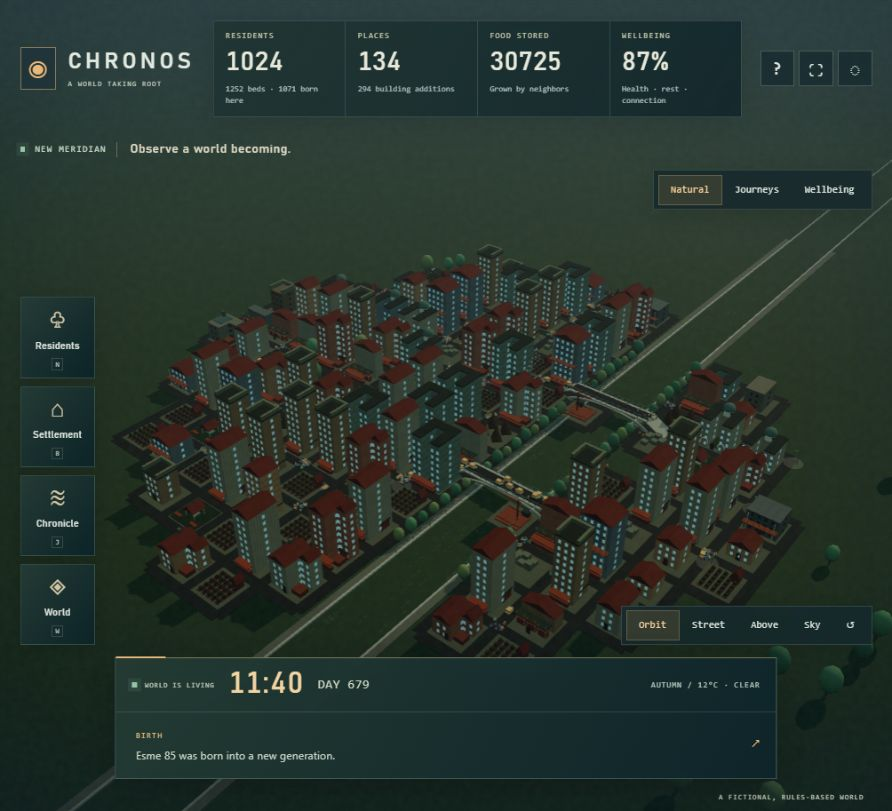

# CHRONOS — A river city taking shape

A continuously living, fictional 3D settlement. Observe households, real cargo, new districts, building additions, reuse and generations. The Sun, Moon, weather and river share the same world clock. There is one world, no comparison view, no rewind and no play/pause controls.



## Open and explore

Open `CHRONOS.html` in a current WebGL-capable browser. It contains its code, textures and styles; no network assets or account are required. Direct file launch is designed for offline use but is not browser-verified here because the test browser blocks that protocol. The HTTP preview is verified.

- Drag to orbit 360°, right-drag to pan, scroll/pinch to zoom. Frame the settlement with ↺. Orbit, Street, Above and Sky are observation cameras.
- Residents / N: search any living resident, inspect needs and household, Locate or Follow. Children are smaller; workers carry props and builders wear helmets.
- Settlement / B: inspect construction, additions, conversions, condition and local stocks. Persistent buildings have distinct footprints, courtyards, roofs and structural components; piers and cranes handle real cargo.
- Chronicle / J: daily population history, events and links to witnesses.
- World / W: stocks, development totals, shipments, pier queues, learned journey estimates, export/import and a confirmed new-world action.
- F follows the selected resident; 1 / 2 / 3 / 4 choose cameras; H hides controls; Escape closes the panel. Buttons and fields retain normal keyboard behavior. The guide explains the rules.

## Life and persistence

A tick represents ten fictional minutes; two ticks advance per real second. A world day takes approximately 72 seconds. A background worker normally advances the model while rendering interpolates timestamped snapshots. Time continues through menus, dialogs and inspection. On return the app recovers elapsed time, including fractional ticks, up to seven real days. It does not run on a server while closed. Long absences can need recovery time.

Housing, labor, local inventories, conserved cargo, food, tools, needs, migration, births and compressed ageing drive the outcomes. Persistent jobs and recovery prevent delayed deliveries freezing the whole city. New land and additions both contribute to growth, while vacancy can lead to reuse or salvage. Growth is conditional: shortages and deaths can slow or reverse it. Bounds are 1,024 living residents, 512 places and 160 active shipments; the clock has no final day. Logs retain 100 events and daily history 120 days.

The environment has a fictional 192-day year, 48-day seasons and an approximately 29.53-day lunar cycle. Temperature, precipitation, mud and river ice affect production and travel. This is an approximate climate/sky model, not a real-world forecast or ice-safety guide. Full banking contagion, rigid-body cargo/fluid physics and coin wagons remain outside this implementation.

A small persisted tabular model learns transport action values from completed deliveries in local, long and crossing contexts. Per-resident delivery experience also persists. It is not a neural society model or a guarantee of improvement on every world. See [model.md](model.md) for the data, update rule and evaluation limits.

Autosave uses `chronos.colony`. Schema-2 living worlds are strictly validated and migrated to schema 3. Before the first automatic replacement, their original raw save is retained locally as `chronos.colony.before-river-city`; World offers a pre-migration export. Existing `chronos.world` timeline saves stay separate and exportable, with the compatible game at `archives/CHRONOS-timelines.html`. Keep portable copies: browser storage is not a backup. Unreadable saves, backup failures and other-tab changes are protected from silent overwrites.

## Source and checks

With Node 22.12+ installed:

```sh
git clone https://github.com/Nikhil-4404/chronos.git
cd chronos
npm ci
npm run dev
```

Open the localhost URL printed by Vite. On Windows PowerShell, use `npm.cmd` if script execution policy blocks `npm`.

```sh
npm test
npm run build
npm run preview
```

The build emits both the regular `dist/` site and self-contained root/dist `CHRONOS.html`; it asserts embedded syntax, no external scripts/styles, license inclusion and a below-1-MB size budget. The repository includes the ready-to-open `CHRONOS.html`. No dependency was added.

`src/colony.js` owns the model, learning and schema-3 validation; `src/colony-v2.js` retains strict migration validation. `src/world-loop.js` and its embedded worker own time, forecasts and checkpoints. `src/app.js` owns observation and storage. `src/environment.js` supplies the shared sky/climate; `src/city.js`, `src/activity.js` and `src/architecture.js` render actual snapshots. `src/simulation.js` retains the earlier schema-1 timeline engine, excluded from the current game bundle.

See [status.md](status.md) for observed checks and remaining limits, [core.md](core.md) for model rules, and [requirements.md](requirements.md) for acceptance criteria. This replaces the active timeline experience at the user's request on 2026-11-06; it is not an additional selectable game mode.

Saved worlds stay in your browser or your own JSON exports. Personal backups are excluded from this repository; a fresh browser starts with the founding settlement. Use World → Export / Import to transfer a colony between browsers.
